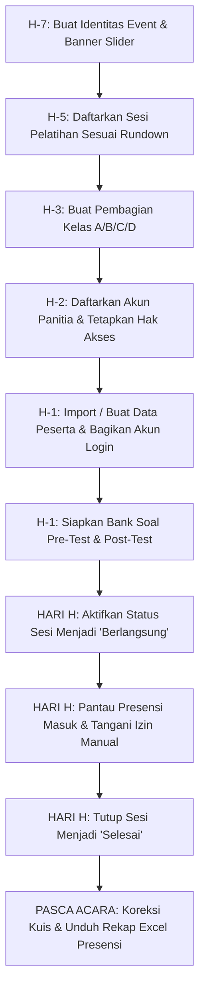

# 📘 Panduan Penggunaan Lengkap PresenTrain: Administrator Utama (Super Admin)

> **Dokumen Resmi Petunjuk Teknis & Operasional Sistem PresenTrain**  
> **Level Akun:** Administrator Utama (`super_admin`)  
> **Target Pengguna:** Pengelola Sistem, Master Panitia Pengarah (SC), dan Penanggung Jawab Training  
> **Akses Portal:** `https://presentrain.web.id/adminutama` atau rute lokal `/adminutama`

---

## 📑 Daftar Isi
1. [Prinsip Kerja & Arsitektur Peran Super Admin](#1-prinsip-kerja--arsitektur-peran-super-admin)
2. [Navigasi Antarmuka (UI Navigation & Layout)](#2-navigasi-antarmuka-ui-navigation--layout)
   - [Sidebar Desktop (Expanded vs Collapsed)](#sidebar-desktop-expanded-vs-collapsed)
   - [Desktop Top Bar](#desktop-top-bar)
   - [Mobile Header & Bottom Navigation Dock](#mobile-header--bottom-navigation-dock)
3. [Tab 1: Beranda (Overview) & Dasbor Kendali](#3-tab-1-beranda-overview--dasbor-kendali)
   - [Kartu Sambutan Dinamis (Welcome Hero 3D)](#kartu-sambutan-dinamis-welcome-hero-3d)
   - [Menu Cepat Grid (Quick Access Tiles)](#menu-cepat-grid-quick-access-tiles)
   - [Metrik Aktivitas Sistem (Audit Stats)](#metrik-aktivitas-sistem-audit-stats)
   - [Monitoring Jadwal Pelatihan & Live Status Sesi](#monitoring-jadwal-pelatihan--live-status-sesi)
4. [Tab 2: Manajemen Kelas (Classes Management)](#4-tab-2-manajemen-kelas-classes-management)
   - [Struktur Kelas Binaan vs Kelas Umum](#struktur-kelas-binaan-vs-kelas-umum)
   - [Membuat & Memodifikasi Kelas](#membuat--memodifikasi-kelas)
   - [Penugasan Admin Kelas & Distribusi Hak Akses](#penugasan-admin-kelas--distribusi-hak-akses)
   - [Eksplorasi Detail Kelas (Peserta, Admin, & Rekap Nilai)](#eksplorasi-detail-kelas-peserta-admin--rekap-nilai)
   - [Spreadsheet Rekap Multi-Sheet Terintegrasi (RekapDataView)](#spreadsheet-rekap-multi-sheet-terintegrasi-rekapdataview)
5. [Tab 3: Kelola Kuis & Evaluasi (Quiz Management)](#5-tab-3-kelola-kuis--evaluasi-quiz-management)
   - [Pusat Bank Soal (Pre-Test & Post-Test)](#pusat-bank-soal-pre-test--post-test)
   - [Google Form Style Quiz Builder](#google-form-style-quiz-builder)
   - [Integritas & Sistem Keamanan Anti-Kecurangan (Anti-Cheat Engine)](#integritas--sistem-keamanan-anti-kecurangan-anti-cheat-engine)
   - [Tinjauan Hasil, Koreksi Nilai, & Reset Percobaan](#tinjauan-hasil-koreksi-nilai--reset-percobaan)
   - [Duplikasi & Penghapusan Kuis](#duplikasi--penghapusan-kuis)
6. [Tab 4: Kelola Admin Panitia (Admin Management)](#6-tab-4-kelola-admin-panitia-admin-management)
   - [Pembuatan Akun Admin Baru & Password Default](#pembuatan-akun-admin-baru--password-default)
   - [Pencarian & Penyaringan Data Admin](#pencarian--penyaringan-data-admin)
   - [Matriks Hak Akses Terperinci (Toggle Switches)](#matriks-hak-akses-terperinci-toggle-switches)
   - [Penugasan Multi-Kelas untuk Admin](#penugasan-multi-kelas-untuk-admin)
   - [Reset Password & Pembekuan Akun Admin](#reset-password--pembekuan-akun-admin)
7. [Tab 5: Master Peserta (Participants Master)](#7-tab-5-master-peserta-participants-master)
   - [Pendaftaran & Pembaruan Data Peserta](#pendaftaran--pembaruan-data-peserta)
   - [Filter Kelas & Mesin Pencari Multi-Parameter](#filter-kelas--mesin-pencari-multi-parameter)
   - [Operasi Massal (Bulk Assign Class)](#operasi-massal-bulk-assign-class)
   - [Menu Aksi Peserta (Titik 3 / Dropdown):](#menu-aksi-peserta-titik-3--dropdown)
     - [Presensi Manual (Hadir / Tidak Hadir)](#presensi-manual-hadir--tidak-hadir)
     - [Pencatatan Alasan Izin / Berhalangan](#pencatatan-alasan-izin--berhalangan)
     - [Pemindahan Kelas & Inspeksi Profil](#pemindahan-kelas--inspeksi-profil)
8. [Tab 6: Manajemen Event & Sesi (Events Management)](#8-tab-6-manajemen-event--sesi-events-management)
   - [Pengaturan Identitas Event, Tanggal, & Banner Slider](#pengaturan-identitas-event-tanggal--banner-slider)
   - [Manajemen Sesi Materi (Tambah, Edit, Ruangan, & Pemateri)](#manajemen-sesi-materi-tambah-edit-ruangan--pemateri)
   - [Pengubah Status Sesi Instan (Dropup Status Switcher)](#pengubah-status-sesi-instan-dropup-status-switcher)
9. [Tab 7: Audit Log Server (System Logs)](#9-tab-7-audit-log-server-system-logs)
   - [Monitoring Jejak Forensik Real-Time](#monitoring-jejak-forensik-real-time)
   - [Penyaringan Log Berdasarkan Modul, Aksi, & User](#penyaringan-log-berdasarkan-modul-aksi--user)
   - [Inspeksi Detail Payload & Jejak IP](#inspeksi-detail-payload--jejak-ip)
10. [Fitur Global Ekspor & Pelaporan](#10-fitur-global-ekspor--pelaporan)
    - [Ekspor Excel Data Peserta Terformat](#ekspor-excel-data-peserta-terformat)
    - [Ekspor Excel Rekapitulasi Presensi Seluruh Sesi](#ekspor-excel-rekapitulasi-presensi-seluruh-sesi)
11. [Pusat Pengaturan, Profil, & Mode Pemeliharaan](#11-pusat-pengaturan-profil--mode-pemeliharaan)
    - [Pengaturan Akun & Keamanan (OTP Gmail System)](#pengaturan-akun--keamanan-otp-gmail-system)
    - [Pengaturan Situs (Site Settings) & Darurat Maintenance](#pengaturan-situs-site-settings--darurat-maintenance)
    - [Profil Akun, Avatar, & Kartu Presensi Digital](#profil-akun-avatar--kartu-presensi-digital)
    - [Helpdesk Terpadu (Pusat Penanganan Tiket Kendala)](#helpdesk-terpadu-pusat-penanganan-tiket-kendala)
12. [SOP & Alur Kerja Standar (Standard Operating Procedure)](#12-sop--alur-kerja-standar-standard-operating-procedure)

---

## 1. Prinsip Kerja & Arsitektur Peran Super Admin

Peran **Administrator Utama** (`super_admin`) adalah pemegang otoritas absolut di PresenTrain. Berbeda dengan panitia biasa (`admin`) yang pergerakannya dapat dibatasi pada kelas tertentu atau modul presensi saja, Super Admin memiliki kapabilitas:

- **Bypass Hak Akses:** Menjangkau seluruh kelas binaan tanpa terikat filter administratif.
- **Master Data Authority:** Membuka akses untuk menambah, menyunting, mereset password, dan menghapus akun peserta maupun sesama admin panitia.
- **Koreksi Override:** Mampu membatalkan presensi, menyetujui reset quiz, maupun mengoreksi nilai langsung pada spreadsheet tanpa memerlukan persetujuan pihak lain.
- **Forensik & Tata Kelola:** Memantau setiap aktivitas login, scan presensi, pengisian nilai, dan percobaan gagal melalui server audit log.

---

## 2. Navigasi Antarmuka (UI Navigation & Layout)

PresenTrain dirancang menggunakan antarmuka modern adaptif (desktop, tablet, dan smartphone).

### Sidebar Desktop (Expanded vs Collapsed)
Pada layar komputer/laptop, navigasi utama berada di panel sisi kiri (Emerald Gradient Theme):
- **Header Sidebar:** Menampilkan logo resmi PresenTrain, nama sistem, serta tombol toggle collapse (`PanelLeftClose` / `PanelLeftOpen`).
- **Tombol Collapse Sidebar:** 
  - Mode **Expanded** (Lebar 256px - 288px): Menampilkan icon dan label teks menu lengkap.
  - Mode **Collapsed** (Lebar 80px): Memadatkan sidebar hanya berupa icon untuk memaksimalkan ruang kerja tabel data. Dilengkapi indikator tooltip otomatis saat kursor diarahkan ke tombol.
- **Daftar Menu Sidebar:**
  1. `Beranda` (`overview`) — Dasbor ringkasan & quick menu
  2. `Manajemen Kelas` (`classes_management`) — Kelola grup & kelas binaan
  3. `Kelola Kuis` (`quiz_management`) — Bank soal, koreksi nilai, & pembuat kuis
  4. `Admin Panitia` (`admin_management`) — Kelola akun panitia & matriks akses
  5. `Master Peserta` (`participants_master`) — Basis data seluruh peserta terdaftar
  6. `Audit Log` (`system_stats`) — Rekam jejak aktivitas sistem secara riil

### Desktop Top Bar
Terletak di bagian atas layar desktop:
- **Widget Waktu & Tanggal Nyata:** Menampilkan jam berjalan (WIB) dengan detikan dan tanggal format `DD/MM/YYYY`.
- **Tombol Sinkronisasi Data (Refresh):** Icon reload (`RotateCw`) dengan animasi putar halus saat proses sinkronisasi background berlangsung. Mengambil state mutakhir database tanpa reload browser penuh.
- **Avatar & Dropdown Profil Super Admin:** Mengklik avatar membuka menu dropdown:
  - `Profil Saya` (`profile`) — Pengelolaan data diri, foto avatar, dan identitas
  - `Pengaturan` (`settings`) — Reset kata sandi OTP Gmail & ganti email akun
  - `Helpdesk & Layanan` (`helpdesk`) — Penanganan tiket kendala dari peserta/panitia
  - `Panduan Penggunaan` (`guide`) — Petunjuk operasional interaktif dalam aplikasi
  - `Keluar Akun` — Mengakhiri sesi login secara aman

### Mobile Header & Bottom Navigation Dock
Pada layar smartphone:
- **Header Atas:** Menampilkan logo ringkas, notifikasi, dan tombol profil.
- **Floating Bottom Dock (Navigasi Bawah):** Menu melayang di bagian bawah dengan 5 tab prioritas (`Beranda`, `Kelas`, `Kuis`, `Admin`, `Peserta`).
- **Sliding Indicator Dinamis:** Indikator lingkaran putih timbul otomatis meluncur ke menu yang sedang aktif. Bottom dock otomatis disembunyikan saat kuis atau formulir intensif sedang dibuka demi kenyamanan visual.

---

## 3. Tab 1: Beranda (Overview) & Dasbor Kendali

Halaman Beranda (`/adminutama/overview`) merupakan pusat komando operasional selama pelatihan berjalan.

### Kartu Sambutan Dinamis (Welcome Hero 3D)
Panel gradien hijau emerald di sudut kiri atas:
- Menyapa pengguna dengan salam kehormatan: *"Selamat Datang, Kanda/Yunda"*.
- Menampilkan ilustrasi 3D maskot PresenTrain dengan efek transisi transparansi halus.
- **3 Cincin Metrik Cepat (Circular Progress Indicators):**
  1. **Total Sesi:** Menghitung jumlah sesi materi yang terdaftar di database.
  2. **Admin Panitia:** Menampilkan rasio panitia aktif yang siap bertugas.
  3. **Total Peserta:** Menghitung total data peserta yang terdata dalam sistem.

### Menu Cepat Grid (Quick Access Tiles)
Di samping kartu sambutan terdapat panel kaca (*glass-panel*) 6 tombol pintasan cepat:
- **Manajemen Kelas:** Melompat langsung ke pengaturan pembagian kelas.
- **Kelola Kuis:** Melompat ke bank soal dan koreksi kuis.
- **Admin Panitia:** Akses kilat penambahan atau izin panitia.
- **Master Peserta:** Menuju tabel data induk peserta.
- **Audit Log Server:** Membuka laporan aktivitas sistem.
- **Ekspor Rekap:** Menjalankan script unduh instan berkas Excel Rekapitulasi Presensi Lengkap tanpa perlu membuka tab lain terlebih dahulu.

### Metrik Aktivitas Sistem (Audit Stats)
Di bawah grid menu terdapat panel monitoring 4 kartu indikator real-time:
1. **Aktivitas Hari Ini:** Jumlah interaksi sistem yang tercatat sejak pukul 00:00 WIB hari ini.
2. **Berhasil (Hari Ini):** Jumlah transaksi presensi, login, dan operasi data yang sukses.
3. **Gagal / Ditolak:** Percobaan presensi duplikat, salah barcode, atau penolakan otentikasi.
4. **Total Riwayat Log:** Akumulasi seluruh baris log yang tersimpan di server.
- Tautan **"Lihat Semua Log →"** di pojok kanan kartu langsung mengarahkan Anda ke tab Audit Log terperinci.

### Monitoring Jadwal Pelatihan & Live Status Sesi
Kartu putih jadwal resmi menampilkan:
- Nama resmi pelatihan, rentang tanggal pelaksanaan, dan venue/lokasi auditorium.
- **Tombol "Edit Sesi Pelatihan":** Membuka formulir pembaruan sesi materi pertama.
- **Tombol "+ Tambah Sesi Baru":** Mengarahkan ke formulir pembuatan sesi materi baru.
- **Kartu Sesi Terdaftar:** Tiap sesi materi ditampilkan dalam kartu terpisah lengkap dengan jam mulai-selesai (WIB), tanggal, nama pemateri, dan ruangan.
- **Status Selector Cepat (Dropup Menu):**
  - Mengklik badge status di tiap kartu sesi memunculkan menu pilihan:
    - 🟡 **Akan Datang (Mendatang):** Sesi belum dibuka untuk absensi.
    - 🟢 **Berlangsung (Sedang Berlangsung):** Mengaktifkan sesi untuk dipindai scanner panitia dan absensi peserta.
    - ⚪ **Selesai:** Sesi ditutup.

---

## 4. Tab 2: Manajemen Kelas (Classes Management)

Halaman ini berfungsi mengatur pengelompokan peserta ke dalam kelas-kelas binaan (misalnya: *Kelas A*, *Kelas B*, *Kelas C*, *Kelas D*) untuk memudahkan pengelolaan materi dan mentoring.

### Struktur Kelas Binaan vs Kelas Umum
- **Kelas Khusus (Binaan):** Memiliki kode kelas unik, admin pendamping khusus, dan rekap penilaian tersendiri.
- **Kelas Umum (Default):** Peserta yang baru mendaftar atau belum dialokasikan ke kelas binaan tertentu akan otomatis berada di Kelas Umum.

### Membuat & Memodifikasi Kelas
1. Klik tombol **"+ Tambah Kelas Baru"** di sudut kanan atas.
2. Masukkan **Nama Kelas** (Contoh: `Kelas A - Lafran Pane`).
3. Sistem akan otomatis men-generate kode kelas unik (misal: `KLS-01`).
4. Klik **"Simpan Kelas"**.
5. Untuk mengedit nama kelas atau menghapusnya, gunakan menu **Titik Tiga (⋮)** pada kartu kelas terkait. Jika kelas dihapus, peserta di dalamnya otomatis dikembalikan ke *Kelas Umum* tanpa kehilangan riwayat data.

### Penugasan Admin Kelas & Distribusi Hak Akses
1. Pada kartu kelas yang dipilih, klik menu **Titik Tiga (⋮)** lalu pilih **"Kelola Admin"**.
2. Muncul modal daftar seluruh admin panitia:
   - Centang kotak di samping nama admin yang ingin ditugaskan mengelola kelas tersebut.
   - Atur hak akses spesifik admin untuk kelas ini:
     - *Presensi & Scanner* (Izin scan barcode kehadiran peserta kelas)
     - *Penilaian Peserta* (Izin input nilai akademis/keaktifan)
     - *Quiz & Test* (Izin memantau evaluasi kuis kelas)
3. Klik **"Simpan Penugasan"**.

### Eksplorasi Detail Kelas (Peserta, Admin, & Rekap Nilai)
Mengklik tombol **"Lihat Detail"** pada kartu kelas akan membuka dasbor komprehensif kelas dengan 3 sub-tab:
- **Sub-Tab Peserta:** Daftar seluruh anggota kelas tersebut, status kehadirannya per materi, persentase kelulusan kehadiran, dan tombol penilaian individual.
- **Sub-Tab Admin:** Daftar nama panitia pengampu kelas tersebut beserta indikator hak aksesnya.
- **Sub-Tab Rekap:** Lembar evaluasi penilaian peserta kelas beserta tombol unduh laporan khusus kelas bersangkutan.

### Spreadsheet Rekap Multi-Sheet Terintegrasi (RekapDataView)
Super Admin memiliki akses eksklusif ke tampilan spreadsheet interaktif multi-lembar:
- **Sheet Tersedia:**
  1. `TOTAL KESELURUHAN` — Rangkuman nilai akhir dan status kelulusan
  2. `A1 Screening` — Penilaian tahap awal pendaftaran
  3. `A2 Absensi` — Matriks presensi lengkap per sesi materi
  4. `A3 Aktivitas Forum` — Keaktifan diskusi dan forum
  5. `A4 Rekapan Aktivitas` — Gabungan nilai keaktifan lapangan
  6. `A5 Tugas` — Resume materi dan penugasan individu/kelompok
  7. `A6 Nilai Tes Tulis` — Skor Pre-Test dan Post-Test
- **Mode Edit Langsung (In-Place Edit):** Tekan tombol *Edit Nilai*, ubah angka pada sel tabel, masukkan alasan koreksi, lalu klik *Simpan Perubahan*. Seluruh perubahan tercatat pada audit log rekap.

---

## 5. Tab 3: Kelola Kuis & Evaluasi (Quiz Management)

Fitur ini merupakan bank soal digital terintegrasi untuk menyelenggarakan Pre-Test (ujian awal masuk) dan Post-Test (ujian evaluasi kelulusan).

### Pusat Bank Soal (Pre-Test & Post-Test)
Daftar seluruh kuis ditampilkan dalam tabel berstruktur:
- Nomor urut
- Judul kuis
- Tipe kuis (Badge Kuning untuk *Pre-Test*, Badge Hijau untuk *Post-Test*)
- Menu aksi (⋮)

### Google Form Style Quiz Builder
Untuk membuat kuis baru:
1. Klik tombol **"+ Buat Kuis Baru"** di kanan atas.
2. Antarmuka berganti menjadi editor formulir modern (mirip Google Forms).
3. Isi parameter kuis:
   - **Judul Kuis:** (Contoh: `Post-Test Wawasan Kebangsaan & Keislaman`)
   - **Deskripsi / Petunjuk Pengerjaan:** Panduan waktu dan aturan pengerjaan bagi peserta.
   - **Tipe Ujian:** Pilih antara `Pre-Test` atau `Post-Test`.
   - **Durasi Waktu:** Tentukan batas hitung mundur pengerjaan (dalam menit).
   - **Nilai Kelulusan (Passing Grade):** Batas minimal nilai kelulusan (Default: 70).
4. Tambahkan Butir Pertanyaan:
   - Masukkan teks pertanyaan.
   - Tentukan jenis soal: Pilihan Ganda (*Multiple Choice*) atau Uraian (*Essay*).
   - Untuk Pilihan Ganda, masukkan opsi A, B, C, D dan tandai **Kunci Jawaban Benar**.
   - Masukkan bobot skor (*Score Weight*) untuk masing-masing butir soal (Sistem otomatis menghitung total bobot soal).
5. Atur urutan soal menggunakan tombol panah atas/bawah atau duplikasi soal.
6. Klik **"Simpan & Publikasikan"**. Kuis akan langsung aktif dan muncul di portal peserta.

### Integritas & Sistem Keamanan Anti-Kecurangan (Anti-Cheat Engine)
Kuis di PresenTrain dipersenjatai mesin pengawasan browser ketat saat dikerjakan oleh peserta:
- **Pengacakan Urutan Soal (Shuffle Engine):** Nomor soal diacak unik per peserta berdasarkan user ID.
- **Pendeteksi Perpindahan Tab (Tab Violation Detection):**
  - **Pelanggaran ke-1:** Peringatan pop-up pertama (Kuning).
  - **Pelanggaran ke-2:** Peringatan keras terakhir (Merah).
  - **Pelanggaran ke-3:** Sistem otomatis mengunci ujian, memaksa pengumpulan lembar jawaban saat itu juga, dan menandai pelanggaran pada hasil.
- **Pencegah Navigasi Keluar (BeforeUnload Guard):** Peserta tidak dapat me-refresh browser atau menekan tombol back browser tanpa dialog peringatan pembatalan ujian.

### Tinjauan Hasil, Koreksi Nilai, & Reset Percobaan
Melalui menu **Titik Tiga (⋮)** pada kuis yang dipilih, klik **"Hasil & Koreksi"**:
- **Tabel Peringkat:** Menampilkan seluruh peserta yang telah mengumpulkan lembar jawaban, nilai otomatis, dan waktu submit.
- **Koreksi Manual Nilai:** Super Admin dapat mengedit skor jika ada penilaian essay atau penyesuaian khusus.
- **Fitur Reset Percobaan (Reset Attempt):** Jika peserta mengalami kendala jaringan atau perangkat saat ujian, Super Admin dapat menekan tombol **"Reset Jawaban"**. Submisi lama akan dihapus dan peserta diizinkan mengerjakan ulang dari awal.

### Duplikasi & Penghapusan Kuis
- **Duplikasi Kuis:** Menyalin seluruh butir soal dan konfigurasi kuis menjadi draf baru tanpa mempengaruhi riwayat kuis sebelumnya (sangat berguna untuk membuat paket soal paralel).
- **Hapus Kuis:** Menghapus kuis permanen dari sistem setelah melewati konfirmasi keamanan.

---

## 6. Tab 4: Kelola Admin Panitia (Admin Management)

Tab ini bertanggung jawab atas tata kelola akun kepanitiaan, delegasi tugas, dan pembagian hak administratif.

### Pembuatan Akun Admin Baru & Password Default
1. Klik tombol **"+ Tambah Admin Baru"**. Formulir inline elegan akan muncul di atas tabel.
2. Lengkapi formulir pendaftaran:
   - **Nama Lengkap Admin Panitia:** Nama panitia beserta gelar jika ada.
   - **Email Resmi Admin (Login):** Alamat email yang digunakan untuk masuk ke portal.
   - **Nomor Telepon / WhatsApp:** Kontak aktif untuk koordinasi.
   - **Divisi / Bagian Panitia:** (Contoh: *Divisi Scanner & Registrasi*, *Instruktur Kelas A*, dsb).
   - **Status Akun:** Tetapkan ke `Aktif`.
   - **Kata Sandi Login:** Default sistem menyediakan `AdminPanitia123!` (dapat diubah sesuai kebutuhan).
3. Klik **"Simpan Akun Admin"**. Data langsung disinkronkan ke database backend.

### Pencarian & Penyaringan Data Admin
Gunakan kolom pencarian pintar di atas tabel untuk memfilter panitia berdasarkan nama, email, nomor handphone, atau divisi kerja secara instan tanpa perlu reload.

### Matriks Hak Akses Terperinci (Toggle Switches)
Untuk mengunci atau membuka akses fitur panitia:
1. Klik menu **Titik Tiga (⋮)** pada akun admin yang dituju, pilih **"Edit Akses"**.
2. Modal sakelar izin (*Toggle Switch*) akan terbuka:
   - **Akses Presensi & Scanner:**
     - `ON`: Panitia dapat membuka kamera scanner barcode dan mencatat kehadiran peserta.
     - `OFF`: Fitur pemindai barcode disembunyikan/dikunci.
   - **Akses Penilaian Peserta:**
     - `ON`: Panitia diizinkan menginput nilai keaktifan, resume, dan ujian peserta kelasnya.
     - `OFF`: Modul penilaian dikunci (hanya baca).
   - **Akses Quiz & Test:**
     - `ON`: Panitia dapat mengelola soal dan melihat lembar hasil ujian.
     - `OFF`: Modul kuis tidak dapat diedit.
   - **Status Aktif Akun:**
     - Mengubah akun antara `Aktif` dan `Nonaktif`.
3. Perubahan tersimpan secara instan dan langsung berlaku pada sesi login admin bersangkutan.

### Penugasan Multi-Kelas untuk Admin
1. Pada menu **Titik Tiga (⋮)** akun admin, pilih **"Atur Kelas"**.
2. Centang satu atau beberapa kelas yang menjadi tanggung jawab panitia tersebut (tersedia fitur *Pilih Semua* dan *Lepas Semua*).
3. Klik **"Simpan Penugasan"**. Admin tersebut kini hanya akan memfokuskan pekerjaannya pada kelas yang ditugaskan.

### Reset Password & Pembekuan Akun Admin
- **Reset Password:** Jika panitia lupa kata sandi, buka formulir edit lalu klik tombol **"Reset Password Admin"**. Password akun otomatis kembali ke `AdminPanitia123!`.
- **Hapus Akun:** Jika masa kepanitiaan selesai atau panitia dibebastugaskan, Super Admin dapat menekan tombol **"Hapus Admin"** setelah menyetujui dialog konfirmasi risiko.

---

## 7. Tab 5: Master Peserta (Participants Master)

Master Peserta merupakan basis data utama seluruh anggota yang mengikuti pelatihan.

### Pendaftaran & Pembaruan Data Peserta
1. Klik tombol **"+ Tambah Peserta Baru"**.
2. Isi formulir data:
   - **Nama Lengkap Peserta:** Nama lengkap sesuai identitas resmi.
   - **Email Peserta:** Digunakan untuk login peserta ke aplikasi mobile/web.
   - **Asal Komisariat / Instansi:** Asal cabang, komisariat, kampus, atau delegasi lembaga.
   - **Nomor Telepon / WhatsApp:** Kontak peserta.
   - **Kata Sandi Login:** Default sistem menyediakan `Peserta123!`.
   - **Penempatan Kelas:** Pilih langsung kelas binaan yang dituju atau biarkan kosong (*Kelas Umum*).
3. Klik **"Simpan Data Peserta"**. Sistem otomatis membuatkan akun login sekaligus **Token Barcode QR 6-Digit Unik**.

### Filter Kelas & Mesin Pencari Multi-Parameter
- **Dropdown Filter Kelas:** Menyaring tabel untuk menampilkan:
  - *Semua Kelas* (Total akumulasi seluruh peserta)
  - *Kelas Umum (Default)* (Peserta yang belum memiliki kelas)
  - *Nama Kelas Khusus* (Hanya peserta yang tergabung pada kelas terpilih)
- **Kolom Pencarian Cepat:** Mendukung pencarian instan berdasarkan nama peserta, alamat email, asal komisariat, maupun nomor token barcode.

### Operasi Massal (Bulk Assign Class)
Jika Anda memiliki puluhan peserta yang belum memiliki kelas dan ingin dimasukkan ke kelas tertentu secara serentak:
1. Centang kotak checklist di samping nama peserta yang diinginkan (atau centang checklist header paling atas untuk memilih seluruh peserta di halaman).
2. Bilah alat hijau **Bulk Action Toolbar** akan melayang di atas tabel (*Contoh: "15 Peserta Ditandai"*).
3. Klik tombol **"Masukkan ke Kelas"**.
4. Pilih kelas tujuan pada pop-up yang muncul.
5. Klik **"Simpan Pemindahan"**. Seluruh peserta yang dipilih otomatis berpindah kelas dalam satu klik.

### Menu Aksi Peserta (Titik 3 / Dropdown):
Mengklik tombol titik tiga di ujung kanan baris peserta membuka tindakan operasional lengkap:

#### Presensi Manual (Hadir / Tidak Hadir)
- **Set Hadir:** Jika kamera scanner panitia terkendala atau peserta tidak membawa HP fisik, Super Admin dapat langsung mengklik opsi ini. Status sesi aktif peserta langsung berubah menjadi `HADIR` dengan rekaman stempel waktu riil.
- **Set Tidak Hadir:** Membatalkan kehadiran atau menandai alpa jika peserta meninggalkan ruangan tanpa izin.

#### Pencatatan Alasan Izin / Berhalangan
- Klik **"Izin / Berhalangan"**.
- Masukkan keterangan atau alasan resmi (misal: *Sakit dengan surat dokter*, *Tugas kampus mendesak*, dll).
- Klik **"Simpan Alasan Izin"**. Kehadiran peserta ditandai dengan badge `IZIN` sehingga persentase kehadirannya tidak dihitung sebagai pelanggaran alpa.

#### Pemindahan Kelas & Inspeksi Profil
- **Assign ke Kelas:** Memindahkan peserta secara individual ke kelas lain kapan saja.
- **Lihat Profil:** Membuka kartu identitas digital peserta lengkap dengan preview foto, detail kontak, dan riwayat presensi tiap sesi.
- **Hapus Peserta:** Menghapus data peserta secara permanen dari server.

---

## 8. Tab 6: Manajemen Event & Sesi (Events Management)

Tab ini mengatur rincian kurikulum kegiatan dan materi pelatihan (`/adminutama/event-sesi`).

### Pengaturan Identitas Event, Tanggal, & Banner Slider
1. Klik tombol **"Edit Informasi Event"**.
2. **Dokumentasi & Banner Slider Event:**
   - Anda dapat mengunggah multi-gambar banner dokumentasi (format JPG/PNG).
   - Banner ini otomatis ditampilkan sebagai slider bergerak di beranda portal seluruh peserta.
   - Klik tombol **✕** pada thumbnail untuk menghapus foto slider yang tidak relevan.
3. **Data Identitas Event:**
   - Nama Event Pelatihan
   - Lokasi / Venue Utama
   - Tanggal Mulai dan Tanggal Selesai (Menggunakan DatePicker interaktif format `DD/MM/YYYY`).
4. Klik **"Simpan Perubahan Event"**.

### Manajemen Sesi Materi (Tambah, Edit, Ruangan, & Pemateri)
Setiap sesi mewakili satu mata kuliah/materi pelatihan:
1. Klik **"+ Tambah Sesi Baru"** (atau klik tombol *Edit* pada kartu sesi yang ada).
2. Formulir layar penuh yang bersih akan terbuka:
   - **Judul Sesi Materi:** (Contoh: *Materi 1 - Sejarah Perjuangan & Konstitusi*).
   - **Nama Pemateri / Speaker:** Nama instruktur atau narasumber pengisi materi.
   - **Ruangan / Hall / Lab:** Lokasi spesifik ruang kelas.
   - **Jam Pelaksanaan:** Waktu mulai s/d waktu selesai (Format waktu WIB).
   - **Tanggal Sesi:** Tanggal materi dibawakan.
   - **Status Sesi Pelatihan:** `Mendatang`, `Berlangsung`, atau `Selesai`.
3. Klik **"Simpan Sesi Baru"** / **"Simpan Perubahan Sesi"**.

### Pengubah Status Sesi Instan (Dropup Status Switcher)
Pada daftar kartu sesi di halaman muka:
- Klik tombol status di pojok kiri bawah kartu sesi.
- Menu dropup ke atas akan muncul tanpa reload halaman:
  - Pilih **Akan Datang** jika materi dijadwalkan nanti.
  - Pilih **Berlangsung** saat pemateri sudah mulai (otomatis memicu kesiapan scanner).
  - Pilih **Selesai** saat materi ditutup.

---

## 9. Tab 7: Audit Log Server (System Logs)

Pusat transparansi dan akuntabilitas sistem (`/adminutama/audit-log`).

### Monitoring Jejak Forensik Real-Time
Setiap aksi penting di sistem direkam ke dalam database audit log server secara otomatis, meliputi:
- Waktu kejadian (Timestamp akurat hingga detik)
- Identitas pelaku (Nama, Email, dan Role Admin)
- Modul yang diakses (`AUTH`, `ATTENDANCE`, `USER_MANAGEMENT`, `QUIZ`, `SETTINGS`)
- Tindakan/Aksi (`LOGIN`, `LOGOUT`, `CREATE`, `UPDATE`, `DELETE`, `SCAN_BARCODE`)
- Status Hasil (`SUCCESS` atau `FAILED`)

### Penyaringan Log Berdasarkan Modul, Aksi, & User
Panel filter di atas tabel memudahkan pelacakan investigasi:
- Filter dropdown berdasarkan Admin Tertentu
- Filter status (*Sukses* atau *Gagal*)
- Filter modul sistem
- Filter rentang tanggal awal dan akhir
- Pencarian kata kunci bebas
- Tombol **"Reset Filter"** untuk mengembalikan tampilan ke default.

### Inspeksi Detail Payload & Jejak IP
Mengklik tombol icon **Mata (Eye)** pada baris log membuka modal informasi mendalam:
- Detail alamat IP pengguna (*IP Address*)
- Browser & Sistem Operasi (*User Agent*)
- Data masukan / Payload JSON yang dikirimkan (sangat krusial untuk membuktikan apakah ada kesalahan input nilai atau kecurangan absensi).

---

## 10. Fitur Global Ekspor & Pelaporan

PresenTrain menyediakan modul ekspor berkas spreadsheet terstruktur yang kompatibel dengan Microsoft Excel, Google Sheets, dan LibreOffice Calc.

### Ekspor Excel Data Peserta Terformat
- **Lokasi Tombol:** Di dalam tab *Master Peserta* -> Klik **"Ekspor Excel Peserta"**.
- **Hasil Berkas:** `Data_Peserta_SuperAdmin_YYYY-MM-DD.xls`.
- **Karakteristik Format:**
  - Dilengkapi Kop Judul Event Resmi dan Waktu Ekspor resmi.
  - Kolom nomor urut, Nama Lengkap Peserta, dan Asal Komisariat.
  - Lebar kolom otomatis menyesuaikan panjang karakter nama (*Auto-fit*).
  - Data otomatis tersortir alfabetis A-Z.
  - Baris footer menyajikan total rekapitulasi jumlah peserta terdaftar.

### Ekspor Excel Rekapitulasi Presensi Seluruh Sesi
- **Lokasi Tombol:** Di dalam Dasbor Beranda (*Tile Ekspor Rekap*) atau di tab *Rekap*.
- **Hasil Berkas:** `Rekap_Presensi_SuperAdmin_LK1_HMI_YYYY-MM-DD.xls`.
- **Karakteristik Format:**
  - Matriks absensi komprehensif seluruh materi dari Sesi 1 hingga Sesi Terakhir.
  - **Pewarnaan Sel Status Otomatis:**
    - Hijau Terang (`HADIR`) lengkap dengan catatan jam scan waktu kehadiran.
    - Kuning Pucat (`IZIN`) lengkap dengan kutipan catatan alasan izin.
    - Abu-abu Lembut (`BELUM ABSEN / ALPA`).
  - Kolom ringkasan persentase kelulusan kehadiran (%) per peserta dengan indikator warna kelulusan.
  - Baris footer rekapitulasi total kehadiran per masing-masing sesi materi.

---

## 11. Pusat Pengaturan, Profil, & Mode Pemeliharaan

### Pengaturan Akun & Keamanan (OTP Gmail System)
Akses melalui Top Bar -> Profil -> **Pengaturan** (`/adminutama/pengaturan`):
- **Kartu 1: Reset Kata Sandi Akun via OTP Gmail:**
  - Masukkan email akun tujuan.
  - Masukkan password baru dan konfirmasi password baru (minimal 6 karakter).
  - Klik *Kirim Kode OTP Ke Gmail*.
  - Masukkan 6-digit kode OTP verifikasi sebelum batas hitung mundur 60 detik berakhir.
  - Password akun otomatis terbarui secara aman.
- **Kartu 2: Ubah Alamat Email Utama via OTP Gmail:**
  - Masukkan email Gmail baru pengganti.
  - Sistem mengirimkan 6-digit kode verifikasi ke inbox email baru tersebut.
  - Masukkan kode OTP dan klik *Verifikasi & Perbarui*.

### Pengaturan Situs (Site Settings) & Darurat Maintenance
Akses melalui form Pengaturan Website:
- **Nama Aplikasi & Tagline:** Kustomisasi nama identitas portal pelatihan.
- **Logo Aplikasi:** Mengganti icon gambar logo utama.
- **Email & WhatsApp Dukungan:** Informasi kontak helpdesk darurat panitia (Terhubung otomatis ke WhatsApp API).
- **Mode Pemeliharaan (Maintenance Mode Switch):**
  - Jika diaktifkan (`ON`), seluruh pengguna umum (peserta dan panitia non-utama) yang membuka website akan diarahkan ke layar **Maintenance Screen** terisolasi.
  - Super Admin tetap dapat login dan mengakses dasbor untuk melakukan perbaikan konfigurasi.
  - Matikan kembali sakelar (`OFF`) saat pemeliharaan selesai.

### Profil Akun, Avatar, & Kartu Presensi Digital
Akses melalui Top Bar -> Profil -> **Profil Saya** (`/adminutama/profil`):
- **Foto Profil / Avatar:**
  - Mengunggah foto profil baru dari galeri komputer/HP (maksimal 5MB).
  - Pilihan *Hapus Foto* untuk kembali ke avatar inisial.
- **Biodata:** Memperbarui nama lengkap, email, komisariat, dan nomor kontak.
- **Unduh QR Code HD (.png):** Menghasilkan berkas gambar barcode presensi Full HD (1200x1200px) berlatar belakang putih tajam siap cetak.
- **Cetak / Unduh ID Card Peserta:** Menghasilkan kartu ID Card potret elegan (720x1080px) lengkap dengan barcode dan nama event.

### Helpdesk Terpadu (Pusat Penanganan Tiket Kendala)
Akses melalui Top Bar -> Profil -> **Helpdesk & Layanan** (`/adminutama/helpdesk`):
- Super Admin berada dalam **Mode Admin Pusat**:
  - Membaca seluruh tiket kendala yang diajukan oleh peserta maupun panitia lapangan.
  - Filter status tiket: `Semua`, `Proses` (Kuning), atau `Selesai` (Hijau).
  - **Balas Tiket:** Mengetik solusi atau instruksi teknis langsung pada tiket bersangkutan.
  - Status tiket otomatis berubah menjadi *Selesai* beserta rekaman stempel waktu penanganan.
  - Peserta yang melapor akan langsung melihat notifikasi solusi di perangkat mereka.

---

## 12. SOP & Alur Kerja Standar (Standard Operating Procedure)

Untuk memastikan kelancaran operasional pelatihan, ikuti alur standar kerja Super Admin berikut:

### Tips & Trik Penting:
1. **Shortcut Tombol `Escape` (Esc):** Anda dapat menutup modal, popup foto profil, dialog konfirmasi, maupun form bantuan apapun secara cepat hanya dengan menekan tombol **Esc** pada keyboard komputer.
2. **Koneksi Kurang Stabil:** Sistem PresenTrain telah dibekali modul sinkronisasi lokal pintar (*Optimistic Local Sync*). Jika internet server sempat terputus sesaat ketika Anda melakukan perubahan presensi atau hak akses, data di layar Anda tetap langsung diperbarui secara visual dan antrean sinkronisasi akan dikirim otomatis saat koneksi pulih.
3. **Keamanan Kredensial:** Setelah pelatihan resmi ditutup, pastikan membekukan (*Nonaktifkan*) akun panitia yang sudah tidak bertugas demi mencegah perubahan data presensi pasca-acara yang tidak diinginkan.

---

*Dokumen ini disusun sebagai pedoman operasional baku PresenTrain. Seluruh hak cipta dan kepemilikan sistem berada di bawah pengelolaan Administrator Utama PresenTrain.*
