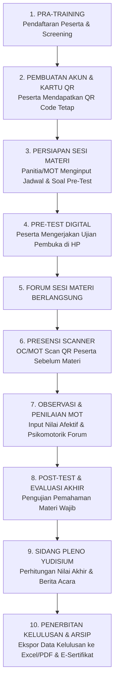

# PresenTrain: Sistem Presensi & Evaluasi Training Perkaderan HMI

> **Solusi Digital Terpadu untuk Manajemen Perkaderan Himpunan Mahasiswa Islam (HMI)**  
> Mendukung jenjang perkaderan formal (**LK I**, **LK II**, **LK III**), non-formal (**Senior Course / SC**, **Training Instruktur BPL**), hingga pelatihan **Lembaga Pengembangan Profesi (LPP)**.

---

## 1. Identitas & Filosofi Nama Aplikasi

### A. Kepanjangan Resmi
**PresenTrain** merupakan akronim dari:
> **Presensi, Evaluasi, dan Manajemen Training Perkaderan HMI**  
> *(Presence, Evaluation, & Training Management System)*

Secara praktis dan komunikatif di arena pelatihan, **PresenTrain** didefinisikan sebagai:
> **Presensi & Evaluasi Training Kader HMI**

### B. Bedah Makna dan Akronim Spesifik

Kata **PresenTrain** menggabungkan dua pilar utama dalam kesuksesan perkaderan:

#### 1. PRESEN (Pilar Presisi, Integritas, & Kehadiran Forum)
* **P** - **Presensi Berbasis Barcode & QR Code Unik**: Tiap peserta memiliki kartu identitas digital dengan QR Code unik permanen untuk check-in per sesi materi.
* **R** - **Rekapitulasi Otomatis & Real-Time**: Kehadiran dihitung langsung per menit tanpa perlu paraf manual di lembar kertas.
* **E** - **Evaluasi Kedisiplinan Peserta**: Pemantauan ketepatan waktu hadir di forum, sholat berjamaah, dan sesi materi malam hingga subuh.
* **S** - **Skrining & Proteksi Anti-Titip Absen**: Sistem *anti-duplicate scan* mencegah pemindaian ganda dan kecurangan absensi.
* **E** - **Efisiensi Administrasi (*Paperless*)**: Mengurangi tumpukan berkas absen fisik yang rawan hilang atau basah di arena training.
* **N** - **Nilai Integritas Kader**: Menanamkan komitmen waktu dan disiplin sebagai perwujudan akhlak kader insan cita.

#### 2. TRAIN (Pilar Perkaderan, Penilaian, & Pengujian Ilmiah)
* **T** - **Training Jenjang Formal & Non-Formal**: Didesain khusus untuk struktur training HMI (LK 1, LK 2, LK 3, SC, TID, TIK, TIM).
* **R** - **Responsibilitas Master of Training (MOT) & Steering Committee (SC)**: Platform penilaian objektif bagi instruktur BPL dan pengarah training.
* **A** - **Afektif, Kognitif, dan Psikomotorik**: Tiga matra penilaian komprehensif kader sesuai pedoman perkaderan HMI.
* **I** - **Integrasi Ujian Digital & Quiz**: Pre-test, Middle-test, Post-test, dan kuis pemahaman materi wajib tanpa aplikasi pihak ketiga.
* **N** - **Navigasi Yudisium Akurat**: Perhitungan persentase nilai akhir otomatis untuk melahirkan kader berkualitas insan akademis, pencipta, dan pengabdi.

---

## 2. Latar Belakang & Urgensi Digitalisasi Perkaderan HMI

Perkaderan adalah jantung organisasi HMI (*jantungnya HMI adalah perkaderan*). Namun, pelaksanaan training sering menghadapi kendala administratif:
1. **Lembar Absensi Konvensional**: Kertas presensi sering tercecer, rusak, atau rentan manipulasi titip absen antar peserta.
2. **Koreksi Manual Ujian Memakan Waktu**: MOT dan SC sering harus memeriksa lembar jawaban pre-test/post-test secara manual hingga larut malam.
3. **Penilaian Subjektif & Fragmentasi Data**: Catatan keaktifan forum dan etika kader kerap tersebar di buku catatan masing-masing instruktur, menyulitkan sidang yudisium kelulusan.
4. **Kebutuhan Rekapitulasi Cepat**: Panitia pelaksana (OC) dan pengurus cabang/komisariat membutuhkan data kehadiran dan kelulusan real-time untuk laporan pertanggungjawaban (LPJ).

**PresenTrain hadir menjawab tantangan tersebut** dengan menyediakan ekosistem terpadu yang menjaga kesakralan nilai-nilai training HMI sekaligus memanfaatkan teknologi modern untuk transparansi, akurasi, dan efisiensi.

---

## 3. Ruang Lingkup Jenjang Pelatihan HMI yang Didukung

PresenTrain dirancang fleksibel untuk seluruh spektrum pelatihan di lingkungan HMI:

```
                                  +-----------------------+
                                  |      PRESENTRAIN      |
                                  +-----------+-----------+
                                              |
         +------------------------------------+------------------------------------+
         |                                    |                                    |
+--------v--------+                  +--------v--------+                  +--------v--------+
| Perkaderan      |                  | Perkaderan      |                  | Diklat Lembaga  |
| Formal HMI      |                  | Non-Formal/BPL  |                  | Khusus / LPP    |
+--------+--------+                  +--------+--------+                  +--------+--------+
         |                                    |                                    |
         |-- Basic Training (LK I)            |-- Senior Course (SC)               |-- LAPMI (Jurnalistik)
         |-- Intermediate Training (LK II)    |-- Training Instruktur (TID/TIK)    |-- LDMI (Dakwah)
         |-- Advance Training (LK III)        |-- Upgrading Pengurus BPL           |-- LEMI (Ekonomi/Bisnis)
                                                                                  |-- LKBHMI / LHMI (Hukum)
                                                                                  |-- LAPENMI (Iptek & Riset)
```

### 1. Basic Training (Latihan Kader I / LK I)
* **Penyelenggara**: Komisariat / Koordinator Komisariat (Korkom) / Cabang.
* **Fokus**: Pembentukan karakter dasar, penanaman doktrin independensi etis dan organisatoris, serta pemahaman materi wajib:
  * Sejarah Perjuangan HMI
  * Konstitusi HMI
  * Mission HMI
  * Nilai-Nilai Dasar Perjuangan (NDP) HMI
  * Kepemimpinan Manajemen Organisasi (KMO)
* **Pemanfaatan PresenTrain**: Absensi sesi materi intensif, screening kelayakan calon peserta, ujian pre-test & post-test materi wajib, penilaian adab forum oleh MOT.

### 2. Intermediate Training (Latihan Kader II / LK II)
* **Penyelenggara**: HMI Tingkat Cabang (Tingkat Regional / Nasional).
* **Fokus**: Pembinaan intelektual, dialektika ilmiah, wawasan kebangsaan, dan kepemimpinan strategis.
* **Pemanfaatan PresenTrain**: Presensi forum seminar/diskusi panel, penilaian makalah/jurnal ilmiah, pengujian wawasan komprehensif, evaluasi dialektika forum.

### 3. Advance Training (Latihan Kader III / LK III)
* **Penyelenggara**: Pengurus Besar (PB) HMI.
* **Fokus**: Pembentukan konseptor peradaban, kepemimpinan berbobot global, dan analisis kebijakan nasional.
* **Pemanfaatan PresenTrain**: Monitoring presensi tingkat tinggi, evaluasi gagasan konseptual, penilaian integritas dan visi kebangsaan peserta.

### 4. Senior Course (SC) & Training Instruktur - Badan Pengelola Latihan (BPL) HMI
* **Penyelenggara**: BPL HMI Cabang / BPL PB HMI.
* **Fokus**: Standarisasi instruktur pengelola latihan, metodologi andragogi, microteaching, dan tata kelola forum training.
* **Pemanfaatan PresenTrain**: Penilaian praktik memandu forum (*micro-training*), pengujian pemahaman pedoman perkaderan, dan simulasi manajemen training digital.

### 5. Pendidikan Khusus Lembaga Pengembangan Profesi (LPP)
* LAPMI (Diklat Jurnalistik), LDMI (Training Dai/Muballigh), LEMI (Training Kewirausahaan), LKBHMI/LHMI (Pelatihan Advokasi Hukum), LAPENMI (Pelatihan Riset/Teknologi), dsb.

---

## 4. Modul & Fitur Unggulan PresenTrain

### 1. Presensi Digital QR Code & Barcode Scanner
* **Kartu Identitas Digital Peserta**: Setiap kader yang terdaftar memiliki kartu QR Code unik yang dapat diakses langsung dari dashboard pribadi di layar ponsel.
* **Pemindaian Cepat Real-Time**: Panitia pelaksana (OC) atau pemandu cukup mengarahkan kamera HP ke QR Code peserta pada saat memasuki ruangan materi.
* **Anti-Titip Absen & Anti-Duplicate**: Sistem otomatis menolak pemindaian berulang untuk sesi yang sama dan mencatat timestamp jam presensi secara presisi (WIB/WITA/WIT).
* **Mode Barcode USB / Input Manual**: Mendukung perangkat pemindai barcode fisik via laptop untuk registrasi meja panitia yang cepat.

### 2. Penilaian Komprehensif Master of Training (MOT) & SC
Sistem mengadopsi standar penilaian perkaderan HMI yang mencakup 3 aspek utama:
* **Aspek Afektif (Sikap, Etika, Akhlak, Adab Forum, Ibadah)**: Nilai ketepatan waktu, kesopanan terhadap instruktur/pemateri, kepatuhan tata tertib, dan akhlakul karimah.
* **Aspek Kognitif (Penguasaan Materi & Daya Nalar)**: Nilai pre-test, post-test, resume materi, dan kemampuan analisis konsep (NDP, Konstitusi, dsb.).
* **Aspek Psikomotorik (Keaktifan & Keterampilan Praktik)**: Keberanian mengemukakan pendapat, memimpin kelompok dinamika forum, presentasi, dan ketahanan fisik forum malam.
* **Catatan Khusus MOT**: Rekam jejak indisipliner (SP1/SP2) atau poin prestasi peserta yang dapat diinput langsung oleh MOT.

### 3. Modul Quiz & Ujian Digital Interaktif (In-App Quiz Builder)
* **Ujian Tanpa Kertas**: MOT/Panitia dapat merancang soal Pre-Test, Post-Test, maupun Quiz Harian langsung di aplikasi (mirip antarmuka Google Forms yang modern).
* **Mendukung Ragam Tipe Soal**: Pilihan ganda, esai singkat, esai analitis, dan studi kasus.
* **Batas Waktu Otomatis (*Timer*)**: Mencegah kecurangan dengan batasan waktu pengerjaan yang ketat di HP peserta.
* **Koreksi & Nilai Otomatis**: Soal pilihan ganda dinilai instan oleh sistem, sedangkan soal esai dapat dinilai langsung oleh tim instruktur BPL dengan mudah.

### 4. Yudisium & Penentuan Kelulusan Otomatis
* **Pembobotan Fleksibel**: Persentase bobot nilai akhir dapat disesuaikan (misal: Kehadiran 20%, Afektif 30%, Kognitif 30%, Psikomotorik 20%).
* **Klasifikasi Kelulusan Resmi HMI**:
  1. *Lulus Murni* (Memenuhi seluruh kriteria batas nilai kelulusan).
  2. *Lulus Bersyarat* (Memerlukan tugas tambahan / resume yang ditetapkan MOT).
  3. *Tidak Lulus* (Gugur karena pelanggaran disiplin atau tidak memenuhi standar minimal nilai).
* **Berita Acara Yudisium Siap Cetak**: Otomatis menghasilkan rekapitulasi nilai akhir dan berita acara yudisium format resmi yang dapat diunduh ke format Excel maupun PDF.

### 5. Progressive Web App (PWA) & Dukungan Offline
* **Instalasi Tanpa App Store / Play Store**: Peserta dan panitia cukup membuka browser web dan memilih tombol "Unduh / Install App" untuk memasang PresenTrain di homescreen ponsel.
* **Ringan & Hemat Kuota**: Dirancang dengan performa tinggi berbasis React & Vite, tetap responsif meski jaringan internet di lokasi training kurang stabil.

---

## 5. Matriks Peran Pengguna (Role-Based Access Control)

| Peran | Pihak Terkait | Hak Akses & Tanggung Jawab Utama |
|---|---|---|
| **Super Admin** | Pengurus HMI Cabang / BPL / Koordinator IT | Mengelola seluruh event training, aktivasi akun instruktur/panitia, konfigurasi identitas cabang/komisariat, serta backup data perkaderan. |
| **Admin (MOT / SC / Panitia)** | Master of Training, Steering Committee, Organizing Committee | Mengoperasikan scanner kehadiran sesi materi, menyusun soal kuis/ujian, menginput nilai afektif/kognitif/psikomotorik, dan memantau jalannya forum. |
| **Peserta Training** | Kader Peserta LK I / LK II / LK III / SC | Menampilkan kartu QR Code identitas digital, melihat jadwal sesi materi, mengerjakan ujian/kuis online, dan memantau nilai serta status kehadiran. |
| **Tampilan Publik** | Tamu / Peninjau / Pengurus | Melihat papan informasi live check-in sesi materi yang sedang berlangsung via layar proyektor aula tanpa perlu login. |

---

## 6. Standar Alur Operasional Training (SOP) dengan PresenTrain



---

## 7. Kesimpulan & Manfaat bagi Perkaderan HMI

1. **Akuntabilitas**: Rekap nilai dan kehadiran tersimpan rapi dan dapat dipertanggungjawabkan di hadapan Konferensi Cabang / Rapat Anggota Komisariat (RAK).
2. **Keadilan & Objektivitas**: Kelulusan kader didasarkan pada data faktual kehadiran materi, nilai ujian murni, dan akumulasi penilaian instruktur.
3. **Efisiensi Waktu MOT**: Instruktur BPL dapat fokus pada pendampingan substansi dan pembinaan mental kader tanpa terbebani teknis manual.
4. **Modernisasi Organisasi**: Mempertegas peran HMI sebagai pelopor perubahan di era revolusi digital dan kecerdasan buatan, mewujudkan kader yang sejati: **Insan Akademis, Pencipta, Pengabdi yang Bernafaskan Islam.**

---
*PresenTrain - Dikembangkan untuk Kemajuan Perkaderan Himpunan Mahasiswa Islam (HMI).*
