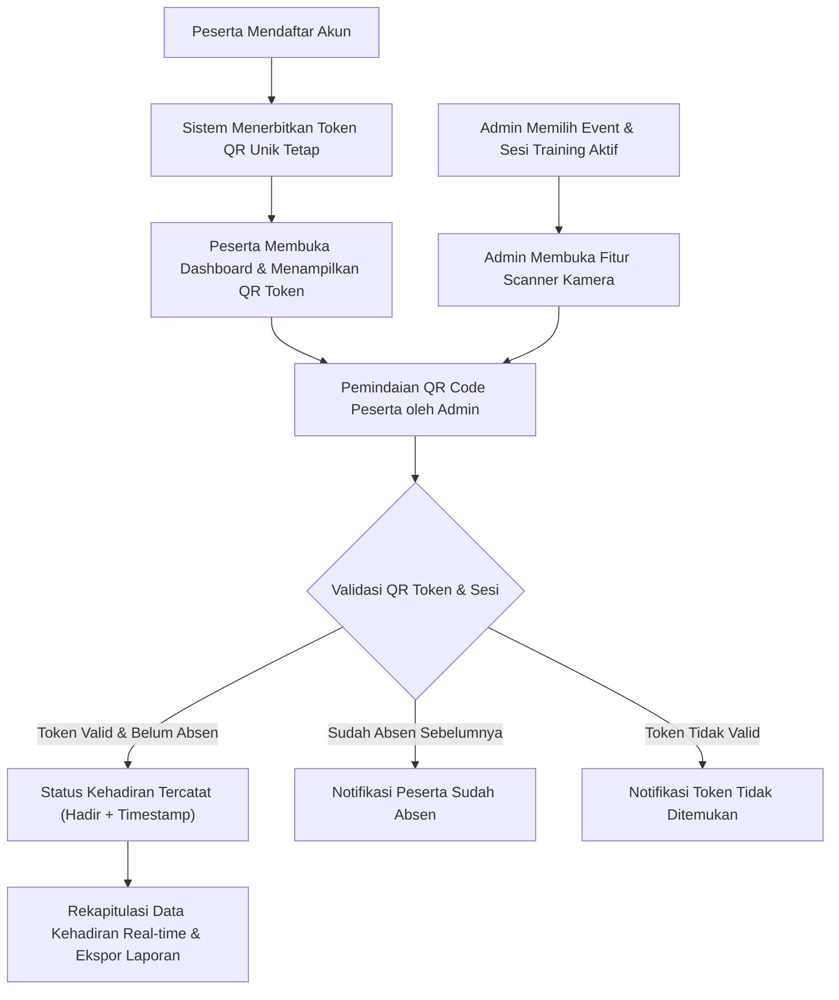

# Dokumentasi Sistem PresenTrain (Web Absensi Training Digital)

Sistem **PresenTrain** (Absentraining) adalah aplikasi web berbasis React yang dirancang untuk mengelola absensi pelatihan/training secara digital menggunakan teknologi **QR Code / Barcode**. Sistem ini menyediakan identitas digital berbasis QR unik yang tetap untuk setiap peserta, fitur pemindaian cepat real-time oleh panitia/admin per sesi materi training, pemantauan kehadiran, serta rekapitulasi data dan pengelolaan sistem secara terpusat.

---

## 1. Stack Teknologi & Spesifikasi Perangkat Lunak

### Frontend Application
- **Core Framework**: React 19 (`react`, `react-dom`)
- **Build Tool & Bundler**: Vite 8 (`vite`, `@vitejs/plugin-react`)
- **CSS Framework**: Tailwind CSS v4 (`@tailwindcss/vite`, `tailwindcss`)
- **Icon Library**: Lucide React (`lucide-react`)
- **Modul QR & Scanner**:
  - `@html5-qrcode` (`^2.3.8`): Modul pemindaian QR Code interaktif menggunakan kamera perangkat (HP / Laptop / Tablet).
  - `qrcode.react` (`^4.2.0`): Generator QR Code dinamis di sisi klien.
  - `canvas-confetti` (`^1.9.4`): Efek selebrasi visual pada antarmuka.
- **Code Quality / Linter**: Oxlint (`oxlint`, `.oxlintrc.json`)

### Backend Integration (Arsitektur Terencana)
- **Framework API**: Laravel 11 RESTful API
- **Autentikasi & Keamanan Token**: Laravel Sanctum (Token-based API Authentication)
- **Basis Data (Database)**: MySQL DB

---

## 2. Hak Akses & Peran Pengguna (Role-Based Access Control)

Aplikasi memiliki 3 tingkat peran pengguna utama serta 1 mode tampilan publik:

```
                      +-------------------+
                      |   PresenTrain     |
                      +---------+---------+
                                |
        +-----------------------+-----------------------+
        |                       |                       |
+-------v-------+       +-------v-------+       +-------v-------+
|  Super Admin  |       | Admin Panitia |       |    Peserta    |
+---------------+       +---------------+       +---------------+
```

### A. Super Admin (Admin Utama)
- **Pengelolaan Akses Admin**: Menambah, mengedit, menonaktifkan akun panitia/admin, serta mengatur ulang kata sandi.
- **Pengaturan Situs & Konfigurasi**:
  - Mengatur nama aplikasi, tagline, logo situs, email kontak support, dan nomor WhatsApp.
  - **Fitur Maintenance Mode**: Mengaktifkan/menonaktifkan mode pemeliharaan sistem global (dengan fasilitas *override* akses khusus Super Admin).
- **Pengelolaan Master Training & Sesi**: Membuat, mengedit, dan menghapus event pelatihan serta rincian sesi materi (pembicara, ruangan, waktu).
- **Pengelolaan Peserta & Rekapitulasi Global**: Melihat seluruh peserta terdaftar, mengubah data peserta, serta mengunduh rekapitulasi kehadiran global (Excel / PDF).

### B. Admin (Panitia / Instruktur)
- **Pemilihan Sesi Aktif**: Memilih event dan sesi materi training yang sedang berlangsung.
- **Pemindaian Presensi (Scanner)**:
  - **Kamera Scanner**: Membuka kamera perangkat via `@html5-qrcode` untuk memindai QR Code unik peserta.
  - **Manual/External Barcode Input**: Mendukung input token manual atau pemindaian via barcode scanner hardware USB.
- **Validasi Kehadiran Real-Time**:
  - Verifikasi otomatis status peserta pada sesi tersebut.
  - Pencegahan pemindaian ganda (*double-scan prevention*) jika peserta dipindai ulang pada sesi yang sama.
- **Monitoring & Laporan**: Memantau daftar statistik kehadiran sesi real-time dan mengunduh laporan sesi (Excel / PDF).

### C. Peserta (Participant)
- **Pendaftaran Akun**: Mendaftar akun baru (langsung **aktif otomatis** tanpa memerlukan persetujuan manual admin).
- **Kartu Identitas Digital**:
  - Dashboard pribadi menampilkan **QR Code & Barcode Unik Tetap** sebagai kartu identitas peserta digital.
  - **Full QR Modal**: Menampilkan QR Code ukuran besar di layar HP agar memudahkan proses scan oleh panitia.
- **Monitoring Kehadiran**: Melihat daftar sesi training, status kehadiran per sesi (Hadir / Belum Hadir), serta pencatatan timestamp jam absen.
- **Panduan Penggunaan**: Akses ke panduan interaktif cara melakukan presensi.

### D. Tampilan Sesi Publik (Public Session View)
- Akses publik langsung melalui URL rute khusus (contoh: `/ABSEN-SESI-1` atau `/sesi-1`).
- Menampilkan papan informasi status sesi, jam berlangsung, pembicara, QR Code check-in publik, dan daftar peserta yang telah hadir tanpa perlu login.

---

## 3. Alur Kerja Sistem (System Workflow)



1. **Pendaftaran & Log In**: Peserta membuat akun, sistem menghasilkan `user_qr_token` unik yang terikat permanen pada akun tersebut.
2. **Penerbitan Identitas Digital**: Pada dashboard peserta, `qrcode.react` merender `user_qr_token` menjadi QR Code / Barcode statis.
3. **Persiapan Sesi**: Admin panitia memilih sesi materi yang sedang berjalan (contoh: *Sesi 2 - Arsitektur REST API*).
4. **Pemindaian**: Admin mengarahkan kamera ke QR Code peserta. Modul `@html5-qrcode` memaca token dan memvalidasinya.
5. **Pencatatan Kehadiran**: Jika valid, sistem memperbarui status kehadiran peserta menjadi `present: true` beserta pencatatan waktu (`time: "10:05 WIB"`).
6. **Pelaporan**: Rekapitulasi kehadiran terupdate secara otomatis dan dapat diekspor ke format Excel atau PDF.

---

## 4. Struktur Data & Skema Database

### A. Struktur Data Frontend (State Management & Mock Data)

Objek data utama disimpan dan dikelola melalui state React dalam `src/data/mockData.js`:

#### 1. Data Training & Sesi (`INITIAL_TRAINING`)
```javascript
{
  id: "TR-2026-001",
  title: "Pelatihan Digital & Modern Web Development 2026",
  dateRange: "20/09/2026 - 22/09/2026",
  location: "Auditorium Utama & Online Class",
  totalParticipants: 524,
  status: "Aktif",
  sessions: [
    {
      id: "SES-01",
      title: "Sesi 1: Keynote & Pembukaan Training",
      speaker: "Dr. Irfan Subagyo",
      room: "Hall A - Lantai 3",
      time: "08:00 - 09:30 WIB",
      date: "20/09/2026",
      status: "Selesai"
    },
    ...
  ]
}
```

#### 2. Data Peserta & Kehadiran (`INITIAL_PARTICIPANTS`)
```javascript
{
  id: "USR-0501",
  name: "Budi Santoso",
  email: "peserta@presentraining.com",
  qrToken: "ABSEN-PESERTA-BUDI-881023",
  instansi: "Universitas Gadjah Mada",
  attendances: {
    "SES-01": { present: true, time: "08:14 WIB" },
    "SES-02": { present: true, time: "10:05 WIB" }
  }
}
```

---

### B. Skema Database MySQL (Backend Target Integration)

```sql
-- Tabel Pengguna (Users)
CREATE TABLE users (
    id BIGINT UNSIGNED AUTO_INCREMENT PRIMARY KEY,
    name VARCHAR(255) NOT NULL,
    email VARCHAR(255) UNIQUE NOT NULL,
    password VARCHAR(255) NOT NULL,
    role ENUM('super_admin', 'admin', 'participant') NOT NULL DEFAULT 'participant',
    phone VARCHAR(50) NULL,
    instansi VARCHAR(255) NULL,
    user_qr_token VARCHAR(100) UNIQUE NOT NULL,
    created_at TIMESTAMP NULL,
    updated_at TIMESTAMP NULL
);

-- Tabel Pelatihan (Trainings)
CREATE TABLE trainings (
    id BIGINT UNSIGNED AUTO_INCREMENT PRIMARY KEY,
    title VARCHAR(255) NOT NULL,
    description TEXT NULL,
    location VARCHAR(255) NULL,
    start_date DATE NOT NULL,
    end_date DATE NOT NULL,
    status ENUM('Draft', 'Aktif', 'Selesai') DEFAULT 'Aktif',
    created_by BIGINT UNSIGNED,
    created_at TIMESTAMP NULL,
    updated_at TIMESTAMP NULL,
    FOREIGN KEY (created_by) REFERENCES users(id) ON DELETE SET NULL
);

-- Tabel Sesi Pelatihan (Training Sessions)
CREATE TABLE training_sessions (
    id BIGINT UNSIGNED AUTO_INCREMENT PRIMARY KEY,
    training_id BIGINT UNSIGNED NOT NULL,
    session_name VARCHAR(255) NOT NULL,
    speaker VARCHAR(255) NULL,
    room VARCHAR(255) NULL,
    session_date DATE NOT NULL,
    start_time TIME NOT NULL,
    end_time TIME NOT NULL,
    status ENUM('Mendatang', 'Berlangsung', 'Selesai') DEFAULT 'Mendatang',
    created_at TIMESTAMP NULL,
    updated_at TIMESTAMP NULL,
    FOREIGN KEY (training_id) REFERENCES trainings(id) ON DELETE CASCADE
);

-- Tabel Pendaftaran Peserta (Registrations)
CREATE TABLE registrations (
    id BIGINT UNSIGNED AUTO_INCREMENT PRIMARY KEY,
    user_id BIGINT UNSIGNED NOT NULL,
    training_id BIGINT UNSIGNED NOT NULL,
    status ENUM('active', 'cancelled') DEFAULT 'active',
    registered_at TIMESTAMP DEFAULT CURRENT_TIMESTAMP,
    FOREIGN KEY (user_id) REFERENCES users(id) ON DELETE CASCADE,
    FOREIGN KEY (training_id) REFERENCES trainings(id) ON DELETE CASCADE
);

-- Tabel Kehadiran (Attendances)
CREATE TABLE attendances (
    id BIGINT UNSIGNED AUTO_INCREMENT PRIMARY KEY,
    registration_id BIGINT UNSIGNED NOT NULL,
    training_session_id BIGINT UNSIGNED NOT NULL,
    scanned_by BIGINT UNSIGNED NOT NULL,
    scanned_at TIMESTAMP DEFAULT CURRENT_TIMESTAMP,
    status ENUM('present', 'absent') DEFAULT 'present',
    FOREIGN KEY (registration_id) REFERENCES registrations(id) ON DELETE CASCADE,
    FOREIGN KEY (training_session_id) REFERENCES training_sessions(id) ON DELETE CASCADE,
    FOREIGN KEY (scanned_by) REFERENCES users(id) ON DELETE CASCADE,
    UNIQUE KEY unique_attendance (registration_id, training_session_id)
);
```

---

## 5. Struktur Direktori Proyek

```
Absentraining/
├── docs/
│   └── brainstorming.md         # Catatan analisis kebutuhan awal proyek
├── public/                      # Aset statis public (logo & gambar)
├── src/
│   ├── components/              # Komponen UI React
│   │   ├── AdminDashboard.jsx        # Dashboard utama untuk Panitia/Admin
│   │   ├── AuthScreen.jsx            # Layar Login & Registrasi
│   │   ├── BottomNav.jsx             # Navigasi bawah untuk perangkat seluler
│   │   ├── CameraScannerModal.jsx    # Modal scanner QR kamera berbasis HTML5
│   │   ├── DesktopTopBar.jsx         # Header bar navigasi khusus desktop
│   │   ├── FullQRModal.jsx           # Modal penyaji QR Code ukuran penuh
│   │   ├── Header.jsx                # Header seluler
│   │   ├── MaintenanceScreen.jsx     # Layar pemberitahuan pemeliharaan sistem
│   │   ├── Onboarding.jsx            # Layar panduan awal aplikasi
│   │   ├── PesertaDashboard.jsx      # Dashboard khusus Peserta
│   │   ├── PublicSessionView.jsx     # Tampilan halaman publik per sesi
│   │   ├── SessionBarcodeModal.jsx   # Modal display Barcode/QR Sesi khusus
│   │   ├── Sidebar.jsx               # Navigation drawer/sidebar desktop
│   │   ├── StatusBar.jsx             # Indikator status jaringan/sistem
│   │   ├── SuperAdminDashboard.jsx   # Dashboard pengelolaan Super Admin
│   │   └── UserGuideModal.jsx        # Modal petunjuk penggunaan
│   ├── data/
│   │   └── mockData.js          # Mock data awal pengguna, training & absensi
│   ├── App.jsx                  # Komponen induk & penanganan routing/state global
│   ├── index.css                # Style global Tailwind CSS v4
│   └── main.jsx                 # Titik masuk utama aplikasi React
├── .gitignore                   # Konfigurasi pengecualian Git
├── .oxlintrc.json               # Konfigurasi linter Oxlint
├── index.html                   # File HTML utama
├── package.json                 # Manifest dependensi & skrip npm
├── README.md                    # Dokumentasi default React + Vite
├── sistem.md                    # Dokumentasi Sistem (File ini)
└── vite.config.js               # Konfigurasi pengematan Vite & Tailwind CSS
```

---

## 6. Panduan Pemeliharaan & Perintah (Scripts)

Untuk menjalankan dan mengelola aplikasi di lingkungan pengembang:

```bash
# 1. Menginstal seluruh dependensi proyek
npm install

# 2. Menjalankan server pengembang lokal (Vite Dev Server)
npm run dev

# 3. Membuat build kompilasi produksi
npm run build

# 4. Menjalankan pratinjau hasil build produksi secara lokal
npm run preview

# 5. Memeriksa kualitas & kesalahan kode menggunakan Oxlint
npm run lint
```

---
*Dokumentasi Sistem PresenTrain ini dibuat sebagai acuan teknis dan operasional pengembangan aplikasi.*
